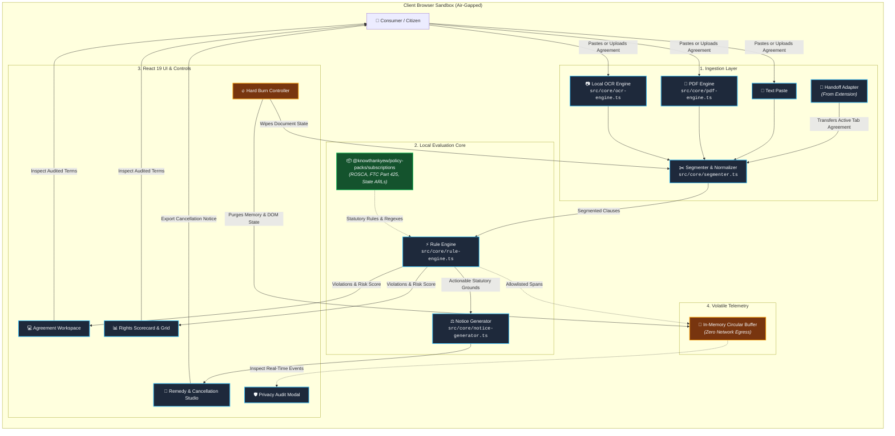
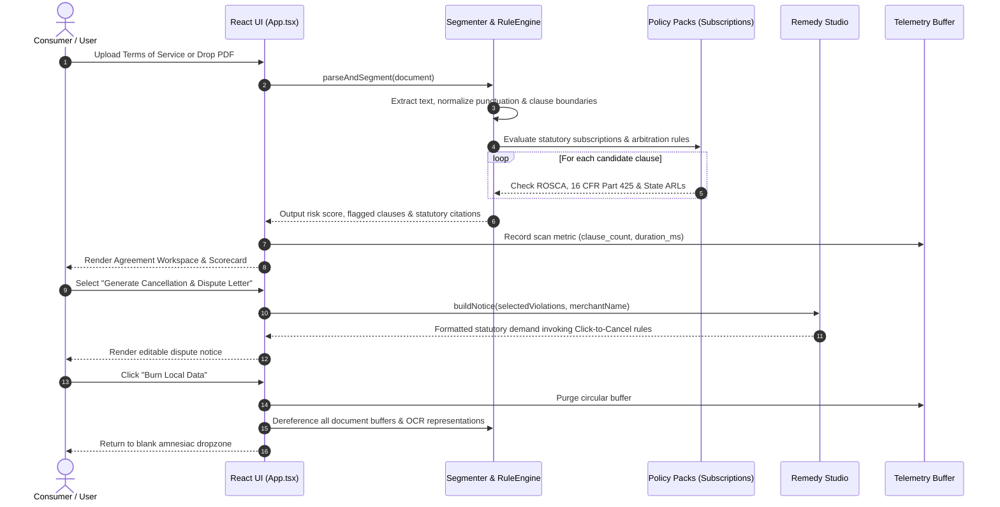

<!-- diagram-meta
  last-validated: 2026-10-26
  validated-commit: 7c57262
  covers: [src/**, contracts/**]
  generated-by: manual
-->

# Architecture & Invariants Specification: Bill of Rights Bot

> Client-side consumer contract auditor, predatory subscription reality engine, and statutory dispute notice generator.

---

## 1. Executive Summary

`bill-of-rights-bot` is a client-side reality engine in the `knowthankyew` portfolio built to eliminate consumer contract asymmetries. It ingests terms of service, subscription agreements, and checkout policies (via text, PDF, or local OCR), auditing clauses against FTC Negative Option rules, ROSCA (15 U.S.C. § 8401), state Automatic Renewal Laws (ARLs), and FAA forced-arbitration precedents. It features an interactive Remedy Studio that generates formal cancellation and statutory dispute demands on local silicon.

---

## 2. System Architecture & Component Interactions

### A. Execution Sandbox & Trust Boundary



### B. Audit & Remedy Notice Lifecycle



---

## 3. Core Architectural Invariants

| # | Invariant | Enforcement & Guarantee |
|:--|:----------|:------------------------|
| 1 | **Zero Document Egress** | Uploaded agreements, PDFs, and OCR scans never leave local browser memory. |
| 2 | **Volatile Memory Telemetry** | Operational telemetry runs strictly in volatile RAM; no cloud or disk logging in consumer builds. |
| 3 | **Strict Key Allowlists** | Telemetry sanitizes properties against `SAFE_ALLOWLIST_KEYS`; contract text, names, and merchant account IDs are redacted. |
| 4 | **Compile-Time Dead Code Shims** | Enterprise network telemetry exporter code is excised at compile time for public consumer builds. |
| 5 | **Amnesiac State Purge (Hard Burn)** | Immediate purge resetting circular buffers, OCR scratch canvases, and DOM state. |

---

## 4. Directory Structure

```
bill-of-rights-bot/
├── docs/
│   ├── ARCHITECTURE.md          # Architecture, data flow & invariant specification
│   └── PRIVACY_TELEMETRY_SCHEMA.md # Telemetry contract specification
├── src/
│   ├── App.tsx                  # Root application view & workflow orchestration
│   ├── main.tsx                 # Entrypoint
│   ├── components/              # UI components (Workspace, Scorecard, RemedyStudio, PrivacyModal)
│   ├── contracts/               # TypeScript interfaces & handoff contracts
│   ├── core/
│   │   ├── segmenter.ts         # Document parser & clause boundary detector
│   │   ├── normalizer.ts        # Text normalization & whitespace cleanup
│   │   ├── rule-engine.ts       # Statutory evaluation engine
│   │   ├── notice-generator.ts  # Statutory cancellation notice generator
│   │   ├── pdf-engine.ts        # Local PDF text extraction
│   │   ├── ocr-engine.ts        # In-browser OCR fallback for scanned images
│   │   ├── handoff-adapter.ts   # Structured Handoff from knowthankyew-extension
│   │   └── telemetry.ts         # In-memory privacy telemetry controller
│   └── styles/                  # Styling & themes
├── tests/                       # Vitest unit & ReDoS test suites
└── vite.config.ts               # Air-gapped bundler configuration
```
